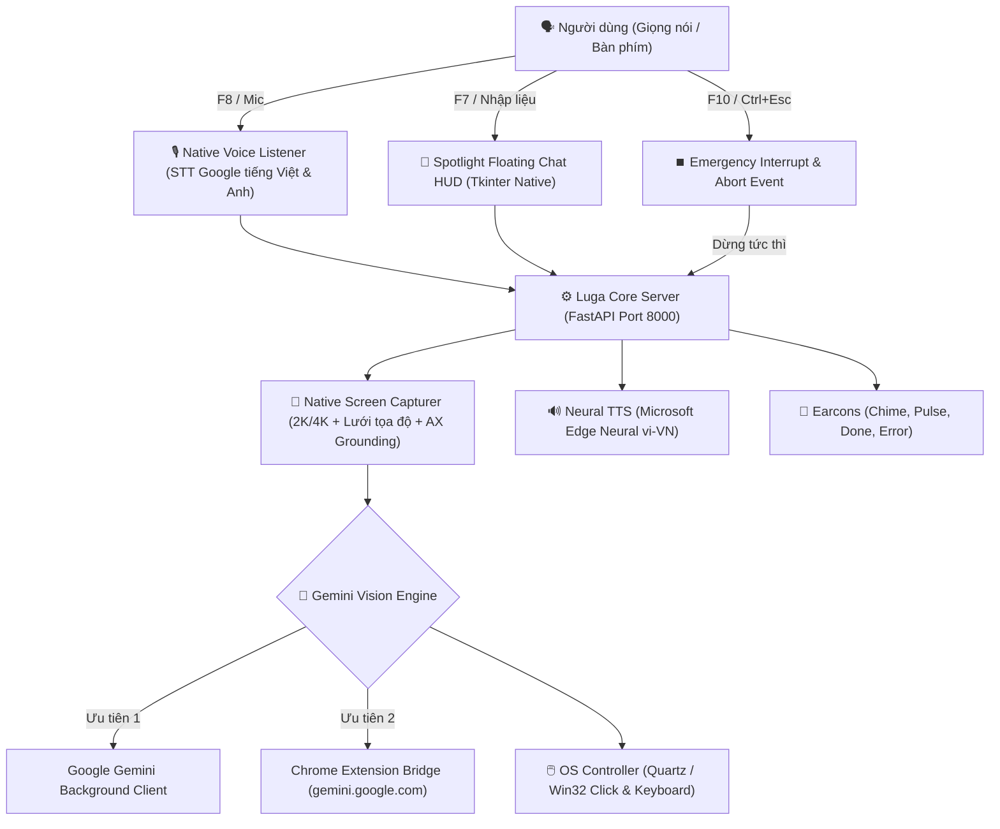

# 🎙️ Luga Assist — AI Computer-Use Assistant for Visually Impaired Users
> **Trợ lý AI điều khiển máy tính hoàn toàn bằng giọng nói tiếng Việt — Hoạt động toàn hệ điều hành, không cần mở trình duyệt, độ chính xác cao.**

[](https://github.com)
[](https://www.python.org/)
[](LICENSE)
[](tests/)

---

## 🇻🇳 TIẾNG VIỆT

### 🌟 Tổng quan dự án

**Luga Assist** là trợ lý trí tuệ nhân tạo thế hệ mới (Vision-Language Computer-Use Agent) được thiết kế đặc biệt nhằm hỗ trợ **người khiếm thị, người giảm thị lực** và người dùng muốn thao tác máy tính **rảnh tay (hands-free)**:
- 🗣️ **100% bằng giọng nói tiếng Việt tự nhiên**: Ra lệnh mở phần mềm, soạn và gửi email, tìm kiếm file, nghe nhạc, điều khiển âm lượng, tắt/bật ứng dụng...
- 🖥️ **Màn hình hoàn toàn thông thoáng (Zero-Browser HUD)**: Không bắt buộc mở tab trình duyệt che khuất màn hình. Trợ lý chạy ngầm với thanh **Chat Nổi Spotlight (F7)** tự động ẩn khi chụp ảnh để AI quan sát 100% không gian làm việc.
- 🎯 **Thị giác máy tính siêu nét (Native 2K/4K Grid)**: Chụp màn hình phân giải cao kết hợp lưới tọa độ 2 tầng (Dual-Tier Percent Grid) và công nghệ khóa phần tử trợ năng (Accessibility Grounding), giúp AI click chuột chuẩn xác từng pixel.
- ⏹️ **Phím tắt ngắt khẩn cấp toàn cầu (F10 / Ctrl + Esc)**: Dừng tức thì mọi thao tác chuột, ngắt micro và dừng giọng nói ngay lập tức khi người dùng yêu cầu.
- 📦 **Bản cài đặt Native cho macOS & Windows**: Khởi chạy 1-click không hiện cửa sổ dòng lệnh (Terminal/CMD).

---

### ⌨️ Bảng phím tắt toàn hệ thống (Global Hotkeys)

Bạn có thể bấm các phím tắt này từ **BẤT KỲ ĐÂU** trên máy tính mà không cần chuyển về cửa sổ Luga:

| Phím tắt | Phím dự phòng | Chức năng chi tiết |
| :--- | :--- | :--- |
| **`F7`** | `Ctrl + Alt + Space` | **Bật / Tắt Cửa sổ Chat Nổi (Spotlight HUD)**: Luôn ở trên cùng, tự động focus ô nhập liệu |
| **`F8`** | `Ctrl + Space` | **Nói lệnh qua Micro**: Phát âm thanh kích hoạt, lắng nghe tiếng Việt và tự động thực thi |
| **`F9`** | `Ctrl + Alt + M` | **Chuyển đổi chế độ**: [Điều khiển máy tính] ⇄ [Trò chuyện hỏi đáp AI] |
| **`F10`** | `Ctrl + Esc` | **⏹️ NGẮT KHẨN CẤP (Cancel / Emergency Stop)**: Dừng ngay tác vụ đang chạy, hủy ghi âm, tắt tiếng đọc |
| **`Esc`** | — | Khi thanh chat đang mở: Hủy tác vụ đang chạy (nếu đang xử lý) hoặc ẩn thanh chat |

---

### 🏛️ Kiến trúc hệ thống



---

### 🚀 Hướng dẫn cài đặt & Khởi động

#### Cách 1: Sử dụng bộ phát hành Release (Không cần cài đặt môi trường)
1. Tải bản release mới nhất từ trang [Releases](https://github.com):
   - **macOS**: Tải `Luga-Assist-macOS.dmg` hoặc `Luga-Assist-macOS.zip`.
   - **Windows**: Tải `Luga-Assist-Windows.zip`.
2. **Trên macOS**:
   - Mở file `.dmg` và kéo `Luga Assist.app` vào thư mục `Applications` (hoặc Desktop).
   - Click đúp để khởi chạy.
   - Khi chạy lần đầu, cấp quyền **Microphone**, **Accessibility (Trợ năng)** và **Screen Recording (Ghi màn hình)** trong *Cài đặt hệ thống (System Settings -> Privacy & Security)*.
3. **Trên Windows**:
   - Giải nén file `.zip`.
   - Click đúp vào `Luga Assist.exe` hoặc file `start_windows.vbs`.

---

#### Cách 2: Chạy từ mã nguồn (Dành cho Lập trình viên)

##### Yêu cầu môi trường:
- Python 3.10 trở lên (hỗ trợ Python 3.10 - 3.14).
- Trình duyệt Google Chrome đã đăng nhập tài khoản Google.

##### 1. Clone kho lưu trữ và cài đặt thư viện:
```bash
git clone https://github.com/your-username/luga-assist.git
cd luga-assist

# macOS / Linux
chmod +x setup.sh start.sh build_macos.sh
./setup.sh

# Windows
setup.bat
```

##### 2. Cài đặt Chrome Extension (Chỉ cần 1 lần duy nhất):
1. Mở Chrome và truy cập `chrome://extensions/`.
2. Bật công tắc **"Chế độ cho nhà phát triển" (Developer mode)** ở góc trên bên phải.
3. Nhấn **"Tải tiện ích đã giải nén" (Load unpacked)** và chọn thư mục `extension/` trong dự án.
4. Tiện ích sẽ tự động đồng bộ phiên Google Gemini của bạn dưới nền.

##### 3. Khởi chạy trợ lý:
- **macOS**: Click đúp vào ứng dụng `Luga Assist.app` trên Desktop hoặc chạy `./start.sh`.
- **Windows**: Click đúp vào file `start_windows.vbs` (chạy ngầm không hiện CMD) hoặc chạy `start.bat`.

---

### 🛠️ Hướng dẫn Build Release cho macOS & Windows

#### Build gói cài đặt cho macOS:
Chạy script đóng gói tự động:
```bash
./build_macos.sh
```
Kết quả được tạo ra trong thư mục `dist/`:
- `dist/Luga-Assist-macOS.dmg`: Đĩa cài đặt chuẩn Apple cho người dùng cuối.
- `dist/Luga-Assist-macOS.zip`: File zip chứa ứng dụng standalone codesigned.
- Tự động cập nhật `Luga Assist.app` ngoài Desktop để thử nghiệm.

#### Build gói cài đặt cho Windows:
Chạy script trên máy Windows:
```bat
build_windows.bat
```
Kết quả được tạo ra trong thư mục `dist/`:
- `dist\Luga Assist\Luga Assist.exe`: File thực thi không hiện màn hình đen (Windowless GUI).
- `dist\Luga-Assist-Windows.zip`: Gói phát hành nén sẵn sàng đưa lên GitHub Release.

---

### 🗣️ Ví dụ câu lệnh mẫu

- **Mở phần mềm & website**:
  - *"Mở Google Chrome cho tôi"*
  - *"Mở phần mềm Spotify"*
  - *"Bật Outlook kiểm tra thư rác"*
- **Email & Soạn thảo**:
  - *"Gửi email cho bạn Phương Mai tiêu đề test nội dung xin chào"*
  - *"Mở thư mục Tài liệu trên màn hình"*
- **Hệ thống & Đa phương tiện**:
  - *"Tăng âm lượng lên"* / *"Tắt tiếng hệ thống"*
  - *"Phóng to cửa sổ đang mở"*
  - *"Đọc to nội dung trên màn hình"*
  - *"Cho máy tính đi ngủ"*

---

## 🇬🇧 ENGLISH

### 🌟 Project Overview

**Luga Assist** is a next-generation Vision-Language Computer-Use Agent designed specifically for **visually impaired users**, accessibility advocates, and anyone seeking complete **hands-free computer control**:
- 🗣️ **Native Vietnamese & English Voice Recognition**: Powered by real-time speech recognition with automatic code-switching and technology term normalization.
- 🖥️ **Zero-Browser Floating Spotlight HUD (F7)**: No bulky browser tabs blocking your view. An elegant floating search bar appears with a single keystroke and hides before taking screenshots.
- 🎯 **Dual-Tier High-Resolution Grid**: 2K/4K Retina screen capturing coupled with an adaptive visual coordinate overlay and native Accessibility API element grounding for pixel-perfect clicking.
- ⏹️ **Global Emergency Stop (F10 / Ctrl + Esc)**: Instantly halts all mouse/keyboard actions, speech playback, and microphone recordings on demand.
- 📦 **Native Standalone Builds**: Windowless native applications for macOS (`.app` / `.dmg`) and Windows (`.exe` / `.zip`).

---

### ⌨️ Global Hotkeys Cheat Sheet

| Hotkey | Secondary Shortcut | Description |
| :--- | :--- | :--- |
| **`F7`** | `Ctrl + Alt + Space` | **Toggle Spotlight Floating HUD**: Always-on-top, auto-focuses text input |
| **`F8`** | `Ctrl + Space` | **Voice Command**: Plays chime, captures spoken audio, and executes autonomously |
| **`F9`** | `Ctrl + Alt + M` | **Toggle Mode**: [Computer Control] ⇄ [Conversational AI] |
| **`F10`** | `Ctrl + Esc` | **⏹️ EMERGENCY CANCEL**: Halts running task, cancels STT, and stops TTS speech |
| **`Esc`** | — | Cancels running execution (if busy) or hides the HUD |

---

### 🏛️ Architecture & Verification Loop

Luga Assist executes multi-step goals via an autonomous perception-action-verification loop:
1. **Perception**: Captures native 2K/4K screenshot + Accessibility tree context.
2. **Grounding**: Overlays coordinate grid and detects interactive UI elements.
3. **Reasoning**: Gemini Vision infers actions and generates verified JSON plans.
4. **Execution**: Quartz/Win32 native clicks, keystrokes, and text inputs.
5. **Outcome Verification**: Takes a post-action screenshot to confirm visual success before reporting back via natural neural TTS audio.

---

### 🧪 Running Tests

Run the full automated test suite (covering prompts, dual-grid capture, coordinate conversion, TTS, audio devices, accessibility supervisor, and emergency cancellation):
```bash
python3 tests/test_pipeline.py
```
Expected output:
```
🎉 ALL TESTS (INCLUDING EMERGENCY STOP & CANCELLATION) PASSED SUCCESSFULLY!
```

---

### 📄 License

This project is licensed under the [MIT License](LICENSE).
