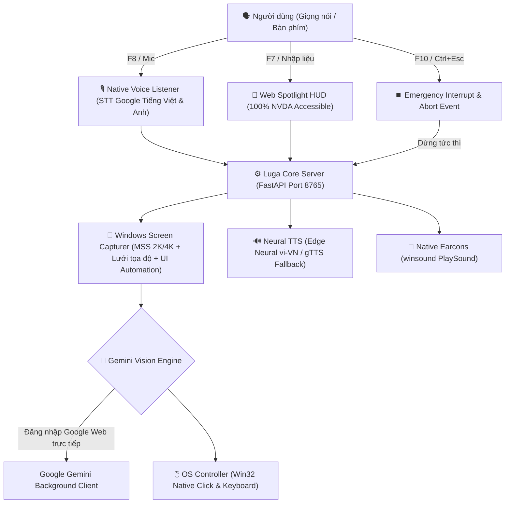

# 🎙️ Luga Assist — AI Computer-Use Assistant for Windows (10 & 11)
> **Trợ lý AI điều khiển máy tính hoàn toàn bằng giọng nói tiếng Việt dành cho Windows — Hoạt động toàn hệ điều hành, không cần mở trình duyệt, độ chính xác cao.**

[](https://github.com)
[](https://www.python.org/)
[](LICENSE)
[](tests/)
[](https://www.nvaccess.org/)
[](http://127.0.0.1:8765)

---

## 🇻🇳 TIẾNG VIỆT

> [!TIP]
> ### 🚀 ĐĂNG NHẬP GOOGLE WEB TRỰC TIẾP — ZERO EXTENSION, ZERO API KEY
> **Luga Assist hỗ trợ đăng nhập tài khoản Google Web trực tiếp 1-click ngay trên cửa sổ Spotlight (F7)!**
> - **Không cần cài Extension trình duyệt**: Loại bỏ hoàn toàn sự phụ thuộc vào tiện ích mở rộng hay chế độ Developer Mode.
> - **Không cần trả phí mua Gemini API Key**: Sử dụng trực tiếp sức mạnh của Google Gemini Web.
> - **Không cần copy/paste cookie thủ công**: Hệ thống tự động bắt phiên làm việc an toàn qua Chromium CDP.
> - Chỉ cần bấm phím **F7**, nhấn **"Đăng nhập Google"** và đăng nhập bình thường. Sau khi xong, trình duyệt sẽ tự động đóng lại và Spotlight khôi phục trạng thái sẵn sàng!

---

### 🌟 Tổng quan dự án

**Luga Assist** là trợ lý trí tuệ nhân tạo thế hệ mới (Vision-Language Computer-Use Agent) được thiết kế tối ưu hóa 100% cho hệ điều hành **Windows (10 & 11)**, đặc biệt hướng đến **người khiếm thị, người giảm thị lực** và người dùng muốn thao tác máy tính **rảnh tay (hands-free)**:

- 🗣️ **100% bằng giọng nói tiếng Việt tự nhiên**: Ra lệnh mở phần mềm, soạn và gửi email, tìm kiếm file, nghe nhạc, điều khiển âm lượng, tắt/bật ứng dụng...
- ♿ **Tương thích 100% trình đọc màn hình NVDA**: Cửa sổ Web Spotlight được thiết kế chuẩn Accessibility với đầy đủ nhãn ARIA, `role="log"`, vùng thông báo trực tiếp `aria-live="polite"` và điều hướng phím Tab hoàn hảo.
- ⚡ **Web Spotlight Độc lập (F7)**: Hoạt động ở chế độ ứng dụng Chromium App Window độc lập không thanh địa chỉ, không tab thừa, tích hợp cơ chế **Single-Instance Toggle** (bấm F7 chỉ bật/tắt 1 cửa sổ duy nhất, tuyệt đối không spam tiến trình).
- 🧠 **Tùy chỉnh Mức độ Suy nghĩ (Thinking Level)**: Lựa chọn linh hoạt giữa **Thấp (Low - Nhanh)**, **Vừa (Medium - Mặc định)**, hoặc **Sâu (High - Phân tích chi tiết)** trực tiếp trên giao diện hoặc qua giọng nói.
- 🎯 **Thị giác máy tính siêu nét (Native 2K/4K Grid)**: Chụp màn hình phân giải cao kết hợp lưới tọa độ 2 tầng (Dual-Tier Percent Grid) và Windows UI Automation, giúp AI định vị và click chuột chuẩn xác từng pixel.
- 🔊 **Phản hồi âm thanh & Giọng đọc thông minh**:
  - Âm thanh Earcon trực quan: Chime khi bắt đầu lắng nghe, Pulse nhịp tim khi đang suy nghĩ, Glass khi hoàn thành, Basso khi có lỗi.
  - Giọng đọc Edge Neural Tiếng Việt & Tiếng Anh chất lượng cao, tự động chuyển tiếp sang gTTS an toàn nếu mạng ngắt quãng.
- ⏹️ **Phím tắt ngắt khẩn cấp toàn cầu (F10 / Ctrl + Esc)**: Dừng tức thì mọi thao tác chuột, ngắt micro và tắt tiếng đọc ngay lập tức.
- 📦 **Bản cài đặt Windows 1-Click**: Tích hợp trình cài đặt Setup (`Luga-Assist-Setup.exe`) tạo sẵn Desktop & Start Menu shortcut, không hiện cửa sổ dòng lệnh đen (CMD).

---

### ⌨️ Bảng phím tắt toàn hệ thống (Windows Hotkeys)

Bạn có thể bấm các phím tắt này từ **BẤT KỲ ĐÂU** trên Windows mà không cần chuyển về cửa sổ Luga:

| Phím tắt | Phím dự phòng | Chức năng chi tiết |
| :--- | :--- | :--- |
| **`F7`** | `Ctrl + Alt + Space` | **Bật / Tắt Cửa sổ Web Spotlight (F7)**: Chế độ 1 cửa sổ duy nhất, tự động focus ô nhập lệnh |
| **`F8`** | `Ctrl + Space` | **Nói lệnh qua Micro**: Phát âm thanh kích hoạt, lắng nghe tiếng Việt và tự động thực thi |
| **`F9`** | `Ctrl + Alt + M` | **Chuyển đổi chế độ**: [Điều khiển máy tính 🎮] ⇄ [Trò chuyện hỏi đáp AI 💬] |
| **`F10`** | `Ctrl + Esc` | **⏹️ NGẮT KHẨN CẤP (Cancel / Emergency Stop)**: Dừng ngay tác vụ đang chạy, hủy ghi âm, tắt tiếng đọc |
| **`Esc`** | — | **Ẩn cửa sổ Spotlight**: Đóng tạm thời giao diện, dịch vụ ngầm vẫn chạy bình thường |
| **`Ctrl + Q`** | — | **🛑 Thoát hoàn toàn**: Tắt toàn bộ ứng dụng Luga Assist với thông báo xác nhận và âm thanh tạm biệt |

---

### 🏛️ Kiến trúc hệ thống trên Windows



---

### 🚀 Hướng dẫn Cài đặt & Khởi động trên Windows

#### Cách 1: Dùng Bộ cài đặt Windows Installer (Khuyên dùng - Không cần cài Python)
1. Tải bản release mới nhất từ trang [Releases](https://github.com/oceanondawave/luga-assist/releases):
   - **`Luga-Assist-Setup.exe`** (Bộ cài đặt tự động Inno Setup).
   - Hoặc **`Luga-Assist-Windows.zip`** (Bản Portable giải nén chạy ngay).
2. Chạy file `Luga-Assist-Setup.exe` và nhấn **Next** để hoàn tất cài đặt.
3. Sau khi cài, icon **Luga Assist** sẽ xuất hiện trên màn hình Desktop và Start Menu.
4. Mở ứng dụng: Luga Assist sẽ chạy ngầm êm ái, sẵn sàng lắng nghe phím tắt `F7`, `F8`, `F9`, `F10`.
5. Bấm **`F7`**, nhấn **"Đăng nhập Google"** để liên kết tài khoản Gemini (chỉ cần làm 1 lần duy nhất).

#### Cách 2: Chạy từ mã nguồn trên Windows (Dành cho Lập trình viên)
1. Mở **Command Prompt (CMD)** hoặc **PowerShell**:
   ```bat
   git clone https://github.com/oceanondawave/luga-assist.git
   cd luga-assist
   setup.bat
   start.bat
   ```
2. Để chạy ngầm hoàn toàn không hiện cửa sổ CMD:
   ```bat
   start_windows.vbs
   ```

---

### 📦 Danh sách file phát hành (Release Assets)

| Tên file phát hành | Định dạng | Hệ điều hành | Mô tả chi tiết |
| :--- | :--- | :--- | :--- |
| **`Luga-Assist-Setup.exe`** | `.exe` | Windows 10 / 11 | **Trình cài đặt tự động chuẩn Windows** (Inno Setup), tự tạo Desktop & Start Menu shortcut |
| **`Luga-Assist-Windows.zip`** | `.zip` | Windows 10 / 11 | **Bản Portable độc lập**, giải nén chạy ngay không cần cài đặt kèm `start_windows.vbs` |

---

### 🛠️ Hướng dẫn Tự Đóng Gói (Build Release)

Để tự đóng gói file `.exe` độc lập và bộ cài đặt trên Windows:
```bat
build_windows.bat
```
Các file thành phẩm sẽ được lưu trong thư mục `dist/`:
- `dist\Luga-Assist-Setup.exe`: Trình cài đặt hoàn chỉnh (yêu cầu Inno Setup 6, tự tải tự động nếu thiếu).
- `dist\Luga Assist\Luga Assist.exe`: File chạy độc lập không cửa sổ console.
- `dist\Luga-Assist-Windows.zip`: File zip phân phối portable (khi thêm cờ `--zip`).

---

### 🗣️ Ví dụ câu lệnh mẫu

- **Mở phần mềm & website**:
  - *"Mở Google Chrome cho tôi"*
  - *"Mở phần mềm Spotify"*
  - *"Mở YouTube tìm bài hát Lạc Trôi"*
- **Email & Soạn thảo**:
  - *"Gửi email cho bạn Phương Mai tiêu đề báo cáo tuần nội dung đã hoàn thành xong"*
  - *"Mở thư mục Documents trên máy"*
  - *"Soạn ghi chú mới trong Notepad"*
- **Hệ thống & Đa phương tiện**:
  - *"Tăng âm lượng lên"* / *"Tắt tiếng hệ thống"*
  - *"Phóng to cửa sổ đang mở"*
  - *"Đọc to nội dung trên màn hình"*
  - *"Cho máy tính đi ngủ"*

---

## 🇬🇧 ENGLISH

> [!TIP]
> ### 🚀 DIRECT GOOGLE WEB LOGIN — ZERO EXTENSIONS, ZERO API KEYS
> **Luga Assist connects to Google Gemini via 1-click web login directly in the Spotlight window (F7)!**
> - **No browser extensions required**: Eliminates unpacked extension loading and developer mode hassle.
> - **No paid Gemini API keys required**: Completely free vision reasoning out-of-the-box.
> - **No manual cookie copying**: Safely captures authenticated session tokens via local Chromium CDP.
> - Press **F7**, click **"Sign in to Google"**, and authenticate normally. The browser automatically closes upon completion and Spotlight resumes immediately!

---

### 🌟 Project Overview

**Luga Assist** is a next-generation Vision-Language Computer-Use Agent designed specifically for **Windows 10 & 11**, empowering **visually impaired users**, accessibility advocates, and anyone seeking complete **hands-free PC control**:

- 🗣️ **Native Vietnamese & English Voice Recognition**: Real-time STT with automatic language code-switching and technology term normalization.
- ♿ **100% NVDA Screen Reader Accessible**: High-contrast, responsive Web Spotlight interface with complete ARIA labels, live announcement regions (`aria-live="polite"`), and smooth keyboard navigation.
- ⚡ **Standalone Web Spotlight (F7)**: Sleek Chromium App mode window with **Single-Instance Toggle** logic (pressing F7 toggles the existing window without spawning duplicate processes).
- 🧠 **Adjustable AI Thinking Levels**: Switch between **Low (Fast)**, **Medium (Default)**, or **High (In-depth analysis)** directly in the UI or via voice.
- 🎯 **Dual-Tier High-Resolution Grid**: Native 2K/4K screenshot capture coupled with visual coordinate overlays and Windows UI Automation for pixel-perfect clicking.
- 🔊 **Rich Auditory Feedback**:
  - Distinct earcons: activation chime, heartbeat pulse during reasoning, success chime, error sound.
  - Neural TTS with automated fallback to gTTS when offline or network drops.
- ⏹️ **Global Emergency Stop (F10 / Ctrl + Esc)**: Instantly halts all mouse/keyboard actions, speech playback, and microphone recordings on demand.
- 📦 **Windows Native Packaging**: Full standalone executable (`Luga Assist.exe`) and Inno Setup installer (`Luga-Assist-Setup.exe`).

---

### ⌨️ Windows Hotkeys Cheat Sheet

| Hotkey | Secondary Shortcut | Description |
| :--- | :--- | :--- |
| **`F7`** | `Ctrl + Alt + Space` | **Toggle Spotlight Web HUD**: Single-instance app window, auto-focuses command input |
| **`F8`** | `Ctrl + Space` | **Voice Command**: Plays chime, captures spoken audio, and executes autonomously |
| **`F9`** | `Ctrl + Alt + M` | **Toggle Mode**: [Computer Control 🎮] ⇄ [Conversational AI 💬] |
| **`F10`** | `Ctrl + Esc` | **⏹️ EMERGENCY CANCEL**: Halts running task, cancels STT, and stops TTS speech |
| **`Esc`** | — | **Hide Spotlight**: Closes/hides the Spotlight window; background service remains active |
| **`Ctrl + Q`** | — | **🛑 Complete Shutdown**: Exits Luga Assist completely with confirmation and goodbye chime |

---

### 🚀 Quick Start on Windows

1. Download and run **`Luga-Assist-Setup.exe`** from [Releases](https://github.com/oceanondawave/luga-assist/releases).
2. Launch **Luga Assist** from your Desktop or Start Menu.
3. Press **`F7`**, click **"Sign in to Google"** (only needed once!).
4. Press **`F8`** to give voice commands or type commands in Spotlight!

---

### 🧪 Running Tests

Run the full automated test suite:
```bash
python3 tests/test_pipeline.py
```
Expected output:
```
🎉 ALL TESTS (INCLUDING EMERGENCY STOP & CANCELLATION) PASSED SUCCESSFULLY!
```

---

### 📄 License

This project is licensed under the [MIT License](LICENSE).
