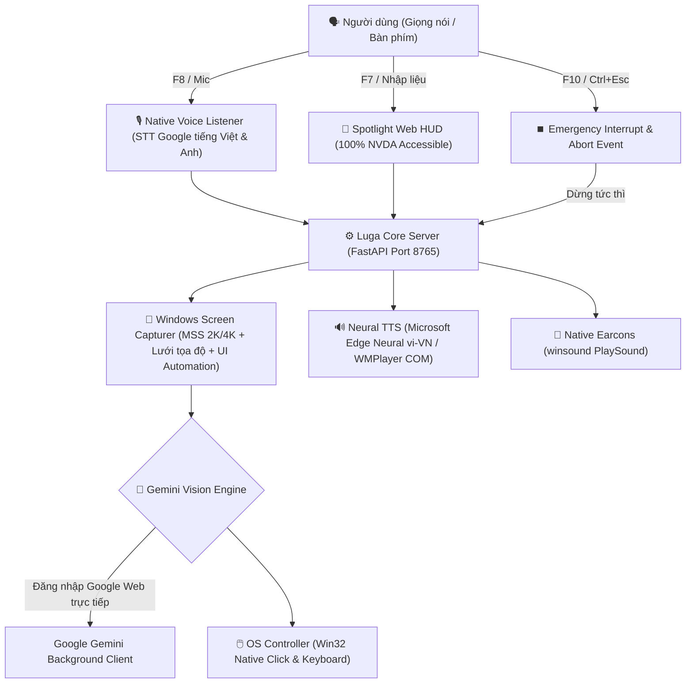

# 🎙️ Luga Assist — AI Computer-Use Assistant for Windows (10 & 11)
> **Trợ lý AI điều khiển máy tính hoàn toàn bằng giọng nói tiếng Việt dành cho Windows — Hoạt động toàn hệ điều hành, không cần mở trình duyệt, độ chính xác cao.**

[](https://github.com)
[](https://www.python.org/)
[](LICENSE)
[](tests/)

---

## 🇻🇳 TIẾNG VIỆT

> [!TIP]
> ### 🚀 ĐĂNG NHẬP GOOGLE WEB TRỰC TIẾP — ZERO EXTENSION, ZERO API KEY
> **Luga Assist hỗ trợ đăng nhập tài khoản Google Web trực tiếp 1-click ngay trên cửa sổ Spotlight (F7)!**
> - **Không cần cài Extension trình duyệt** (Không cần thao tác nạp unpacked hay Developer mode).
> - **Không cần trả phí mua Gemini API Key**.
> - **Không cần copy/paste cookie thủ công**.
> - Bạn chỉ cần bấm phím **F7**, chọn **"Đăng nhập Google"** trên giao diện Spotlight và đăng nhập tài khoản Google của mình như duyệt web thông thường. Luga Assist sẽ tự động nhận diện và kết nối ngầm ngay lập tức!

### 🌟 Tổng quan dự án

**Luga Assist** là trợ lý trí tuệ nhân tạo thế hệ mới (Vision-Language Computer-Use Agent) được thiết kế tối ưu hóa 100% cho hệ điều hành **Windows (10 & 11)**, nhằm hỗ trợ **người khiếm thị, người giảm thị lực** và người dùng muốn thao tác máy tính **rảnh tay (hands-free)**:
- 🗣️ **100% bằng giọng nói tiếng Việt tự nhiên**: Ra lệnh mở phần mềm, soạn và gửi email, tìm kiếm file, nghe nhạc, điều khiển âm lượng, tắt/bật ứng dụng...
- ⌨️ **Phím chức năng F nguyên bản trên bàn phím PC**: Sử dụng các phím chuẩn `F7`, `F8`, `F9`, `F10` trực tiếp, không bị hệ điều hành chặn phím, không cần bấm kèm phím Fn!
- 🖥️ **Màn hình thông thoáng (Zero-Browser HUD)**: Không bắt buộc mở tab trình duyệt che khuất màn hình. Trợ lý chạy ngầm với thanh **Chat Nổi Spotlight (F7)** tự động ẩn khi chụp ảnh để AI quan sát 100% màn hình Windows.
- 🎯 **Thị giác máy tính siêu nét (Native 2K/4K Grid)**: Chụp màn hình phân giải cao kết hợp lưới tọa độ 2 tầng (Dual-Tier Percent Grid) và Windows UI Automation, giúp AI click chuột chuẩn xác từng pixel trên mọi kích thước màn hình.
- ⏹️ **Phím tắt ngắt khẩn cấp toàn cầu (F10 / Ctrl + Esc)**: Dừng tức thì mọi thao tác chuột, ngắt micro và dừng giọng nói ngay lập tức khi người dùng yêu cầu.
- 📦 **Bản cài đặt Windows 1-Click**: Tích hợp trình cài đặt Setup (`Luga-Assist-Windows-Installer.exe`) hoặc file chạy độc lập (`Luga Assist.exe`), không hiện cửa sổ dòng lệnh đen (CMD).

---

### ⌨️ Bảng phím tắt toàn hệ thống (Windows Hotkeys)

Bạn có thể bấm các phím tắt này từ **BẤT KỲ ĐÂU** trên Windows mà không cần chuyển về cửa sổ Luga:

| Phím tắt | Phím dự phòng | Chức năng chi tiết |
| :--- | :--- | :--- |
| **`F7`** | `Ctrl + Alt + Space` | **Bật / Tắt Cửa sổ Chat Nổi (Spotlight HUD)**: Luôn ở trên cùng, tự động focus ô nhập liệu |
| **`F8`** | `Ctrl + Space` | **Nói lệnh qua Micro**: Phát âm thanh kích hoạt, lắng nghe tiếng Việt và tự động thực thi |
| **`F9`** | `Ctrl + Alt + M` | **Chuyển đổi chế độ**: [Điều khiển máy tính] ⇄ [Trò chuyện hỏi đáp AI] |
| **`F10`** | `Ctrl + Esc` | **⏹️ NGẮT KHẨN CẤP (Cancel / Emergency Stop)**: Dừng ngay tác vụ đang chạy, hủy ghi âm, tắt tiếng đọc |
| **`Esc`** | — | Khi thanh chat đang mở: Hủy tác vụ đang chạy (nếu đang xử lý) hoặc ẩn thanh chat |

---

### 🏛️ Kiến trúc hệ thống trên Windows



---

### 🚀 Hướng dẫn Cài đặt & Khởi động trên Windows

#### Cách 1: Dùng Bộ cài đặt Windows Installer (Khuyên dùng - Không cần cài Python)
1. Tải bản release mới nhất từ trang [Releases](https://github.com/oceanondawave/luga-assist/releases):
   - `Luga-Assist-Setup.exe` (Trình cài đặt tự động).
   - Hoặc `Luga-Assist-Windows.zip` (Bản Portable giải nén chạy ngay).
2. Chạy `Luga-Assist-Setup.exe` và làm theo hướng dẫn trên màn hình.
3. Sau khi cài đặt, biểu tượng **Luga Assist** sẽ xuất hiện trên màn hình Desktop và Start Menu.
4. Mở ứng dụng: Luga Assist sẽ chạy ngầm êm ái, sẵn sàng lắng nghe các phím `F7`, `F8`, `F9`, `F10`.
5. Nhấn **`F7`**, chọn **"Đăng nhập Google"** để liên kết tài khoản Gemini (chỉ cần làm 1 lần duy nhất).

#### Cách 2: Chạy từ mã nguồn trên Windows (Dành cho Lập trình viên)
1. Mở **Command Prompt (CMD)** hoặc **PowerShell**:
   ```bat
   git clone https://github.com/oceanondawave/luga-assist.git
   cd luga-assist
   setup.bat
   start.bat
   ```
2. Để chạy ngầm hoàn toàn không hiện cửa sổ CMD:
   ```bat
   start_windows.vbs
   ```

---

### 📦 Danh sách file phát hành (Release Assets)

| Tên file phát hành | Định dạng | Hệ điều hành | Mô tả chi tiết |
| :--- | :--- | :--- | :--- |
| **`Luga-Assist-Setup.exe`** | `.exe` | Windows 10 / 11 | **Trình cài đặt trọn gói** (Inno Setup), tự tạo Shortcut Desktop & Start Menu |
| **`Luga-Assist-Windows.zip`** | `.zip` | Windows 10 / 11 | Bản Portable độc lập chạy ngay kèm Silent Launcher |

---

### 🛠️ Hướng dẫn Tự Build Release trên Windows

Để tự đóng gói file `.exe` và bộ cài đặt trên Windows:
```bat
build_windows.bat
```
Kết quả được tạo ra trong thư mục `dist/`:
- `dist\Luga Assist\Luga Assist.exe`: File thực thi standalone không hiện CMD.
- `dist\Luga-Assist-Windows.zip`: File zip phân phối portable.
- `dist\Luga-Assist-Windows-Installer.exe`: Trình cài đặt hoàn chỉnh (nếu máy có Inno Setup).

---

### 🗣️ Ví dụ câu lệnh mẫu

- **Mở phần mềm & website**:
  - *"Mở Google Chrome cho tôi"*
  - *"Mở phần mềm Spotify"*
  - *"Bật Outlook kiểm tra thư rác"*
- **Email & Soạn thảo**:
  - *"Gửi email cho bạn Phương Mai tiêu đề test nội dung xin chào"*
  - *"Mở thư mục Documents trên máy"*
- **Hệ thống & Đa phương tiện**:
  - *"Tăng âm lượng lên"* / *"Tắt tiếng hệ thống"*
  - *"Phóng to cửa sổ đang mở"*
  - *"Đọc to nội dung trên màn hình"*
  - *"Cho máy tính đi ngủ"*

---

## 🇬🇧 ENGLISH

> [!TIP]
> ### 🚀 DIRECT GOOGLE WEB LOGIN — ZERO EXTENSIONS, ZERO API KEYS
> **Luga Assist connects to Google Gemini via 1-click web login directly in the Spotlight window (F7)!**
> - **No browser extensions required** (No unpacked extension loading or developer mode).
> - **No paid Gemini API keys required**.
> - **No manual cookie copying**.
> - Simply press **F7**, click **"Sign in to Google"**, and authenticate as you normally do on the web. Luga Assist automatically hooks the background session and closes the browser window!

### 🌟 Project Overview

**Luga Assist** is a next-generation Vision-Language Computer-Use Agent designed specifically for **Windows 10 & 11**, empowering **visually impaired users**, accessibility advocates, and anyone seeking complete **hands-free PC control**:
- 🗣️ **Native Vietnamese & English Voice Recognition**: Powered by real-time speech recognition with automatic code-switching and technology term normalization.
- ⌨️ **Standard PC Function Keys**: Native `F7`, `F8`, `F9`, `F10` hotkeys without media key interference or Fn-key friction!
- 🖥️ **Zero-Browser Floating Spotlight HUD (F7)**: No bulky browser tabs blocking your view. An elegant floating search bar appears with a single keystroke and hides before taking screenshots.
- 🎯 **Dual-Tier High-Resolution Grid**: Native screen capturing coupled with an adaptive visual coordinate overlay and Windows UI Automation for pixel-perfect clicking.
- ⏹️ **Global Emergency Stop (F10 / Ctrl + Esc)**: Instantly halts all mouse/keyboard actions, speech playback, and microphone recordings on demand.
- 📦 **Windows Native Packaging**: Full standalone executable (`Luga Assist.exe`) and Inno Setup installer (`Luga-Assist-Setup.exe`).

---

### ⌨️ Windows Hotkeys Cheat Sheet

| Hotkey | Secondary Shortcut | Description |
| :--- | :--- | :--- |
| **`F7`** | `Ctrl + Alt + Space` | **Toggle Spotlight Floating HUD**: Always-on-top, auto-focuses text input |
| **`F8`** | `Ctrl + Space` | **Voice Command**: Plays chime, captures spoken audio, and executes autonomously |
| **`F9`** | `Ctrl + Alt + M` | **Toggle Mode**: [Computer Control] ⇄ [Conversational AI] |
| **`F10`** | `Ctrl + Esc` | **⏹️ EMERGENCY CANCEL**: Halts running task, cancels STT, and stops TTS speech |
| **`Esc`** | — | Cancels running execution (if busy) or hides the HUD |

---

### 🚀 Quick Start on Windows

1. Download and run `Luga-Assist-Setup.exe` from [Releases](https://github.com/oceanondawave/luga-assist/releases).
2. Launch **Luga Assist** from your Desktop or Start Menu.
3. Press **`F7`**, click **"Sign in to Google"** (only once!).
4. Press **`F8`** to give voice commands or type in Spotlight!

---

### 🧪 Running Tests

Run the full automated test suite:
```bash
python tests/test_pipeline.py
```
Expected output:
```
🎉 ALL TESTS (INCLUDING EMERGENCY STOP & CANCELLATION) PASSED SUCCESSFULLY!
```

---

### 📄 License

This project is licensed under the [MIT License](LICENSE).
