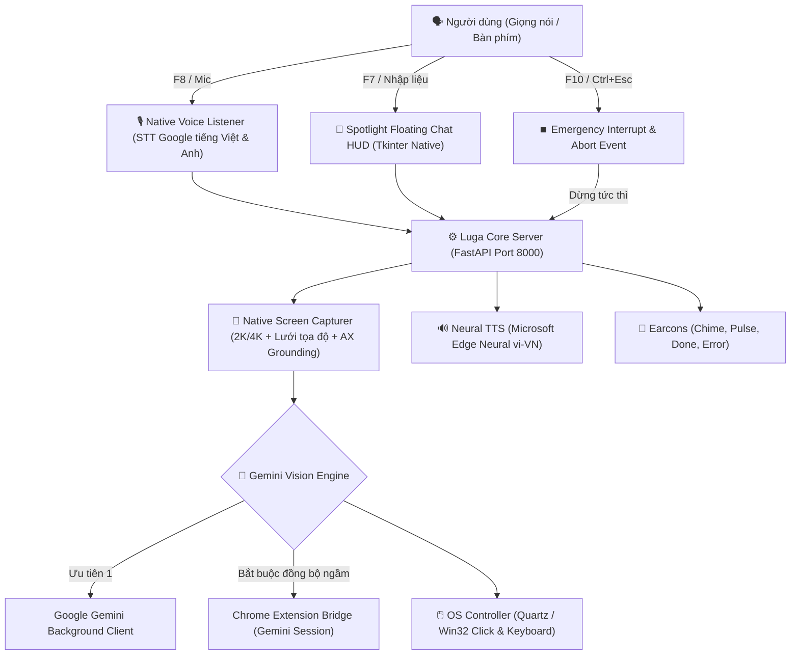

# 🎙️ Luga Assist — AI Computer-Use Assistant for Visually Impaired Users
> **Trợ lý AI điều khiển máy tính hoàn toàn bằng giọng nói tiếng Việt — Hoạt động toàn hệ điều hành, không cần mở trình duyệt, độ chính xác cao.**

[](https://github.com)
[](https://www.python.org/)
[](LICENSE)
[](tests/)

---

## 🇻🇳 TIẾNG VIỆT

> [!IMPORTANT]
> ### ⚠️ ĐIỀU KIỆN BẮT BUỘC: PHẢI CÀI ĐẶT EXTENSION TRÌNH DUYỆT
> **Luga Assist BẮT BUỘC PHẢI CÓ Tiện ích mở rộng (Browser Extension) trên Google Chrome / Edge / Brave / Cốc Cốc để hoạt động!**
> 
> ❓ **Tại sao Extension là bắt buộc?**
> - Extension đóng vai trò là cầu nối bảo mật (Bridge), tự động đồng bộ phiên đăng nhập Google Gemini (`__Secure-1PSID`) từ trình duyệt của bạn vào trợ lý Luga Assist chạy ngầm.
> - **Lợi ích vượt trội**: Giúp bạn sử dụng mô hình trí tuệ nhân tạo Gemini Vision hoàn toàn **miễn phí**, **không tốn tiền mua API key**, **không cần cấu hình phức tạp**, và **hoàn toàn chạy ngầm (không cần mở tab hay cửa sổ trình duyệt nào)**.
> - Nếu không cài Extension, Luga Assist sẽ không thể kết nối tới bộ não Gemini để quan sát màn hình và điều khiển máy tính.

### 🌟 Tổng quan dự án

**Luga Assist** là trợ lý trí tuệ nhân tạo thế hệ mới (Vision-Language Computer-Use Agent) được thiết kế đặc biệt nhằm hỗ trợ **người khiếm thị, người giảm thị lực** và người dùng muốn thao tác máy tính **rảnh tay (hands-free)**:
- 🗣️ **100% bằng giọng nói tiếng Việt tự nhiên**: Ra lệnh mở phần mềm, soạn và gửi email, tìm kiếm file, nghe nhạc, điều khiển âm lượng, tắt/bật ứng dụng...
- 🖥️ **Màn hình hoàn toàn thông thoáng (Zero-Browser HUD)**: Không bắt buộc mở tab trình duyệt che khuất màn hình. Trợ lý chạy ngầm với thanh **Chat Nổi Spotlight (F7)** tự động ẩn khi chụp ảnh để AI quan sát 100% không gian làm việc.
- 🎯 **Thị giác máy tính siêu nét (Native 2K/4K Grid)**: Chụp màn hình phân giải cao kết hợp lưới tọa độ 2 tầng (Dual-Tier Percent Grid) và công nghệ khóa phần tử trợ năng (Accessibility Grounding), giúp AI click chuột chuẩn xác từng pixel trên mọi kích thước màn hình (1080p, 2K, 4K, laptop).
- ⏹️ **Phím tắt ngắt khẩn cấp toàn cầu (F10 / Ctrl + Esc)**: Dừng tức thì mọi thao tác chuột, ngắt micro và dừng giọng nói ngay lập tức khi người dùng yêu cầu.
- 📦 **Bản cài đặt Native cho macOS & Windows**: Khởi chạy 1-click không hiện cửa sổ dòng lệnh (Terminal/CMD).

---

### ⌨️ Bảng phím tắt toàn hệ thống (Global Hotkeys)

Bạn có thể bấm các phím tắt này từ **BẤT KỲ ĐÂU** trên máy tính mà không cần chuyển về cửa sổ Luga:

| Phím tắt | Phím dự phòng | Chức năng chi tiết |
| :--- | :--- | :--- |
| **`F7`** | `Ctrl + Alt + Space` | **Bật / Tắt Cửa sổ Chat Nổi (Spotlight HUD)**: Luôn ở trên cùng, tự động focus ô nhập liệu |
| **`F8`** | `Ctrl + Space` | **Nói lệnh qua Micro**: Phát âm thanh kích hoạt, lắng nghe tiếng Việt và tự động thực thi |
| **`F9`** | `Ctrl + Alt + M` | **Chuyển đổi chế độ**: [Điều khiển máy tính] ⇄ [Trò chuyện hỏi đáp AI] |
| **`F10`** | `Ctrl + Esc` | **⏹️ NGẮT KHẨN CẤP (Cancel / Emergency Stop)**: Dừng ngay tác vụ đang chạy, hủy ghi âm, tắt tiếng đọc |
| **`Esc`** | — | Khi thanh chat đang mở: Hủy tác vụ đang chạy (nếu đang xử lý) hoặc ẩn thanh chat |

---

### 🏛️ Kiến trúc hệ thống



---

### 🚀 Hướng dẫn cài đặt & Khởi động

#### 🔴 BƯỚC 1 (BẮT BUỘC): Cài đặt Tiện ích Extension vào trình duyệt
> *(Chỉ cần thực hiện 1 lần duy nhất trên máy)*

1. **Chuẩn bị thư mục Extension**:
   - **Tải từ Release**: Tải file `Luga-Assist-Chrome-Extension.zip` từ trang Releases rồi giải nén ra thư mục `extension`. *(Nếu bạn dùng file macOS `.dmg`, thư mục `Chrome_Extension` đã có sẵn ngay bên trong đĩa cài đặt!)*
   - **Hoặc từ Source code**: Thư mục `extension/` đã có sẵn trong thư mục dự án sau khi clone.
2. **Nạp Extension vào trình duyệt**:
   - Mở **Google Chrome** (hoặc Edge / Brave / Cốc Cốc).
   - Truy cập địa chỉ: `chrome://extensions/` *(trên Edge: `edge://extensions/`)*.
   - Bật công tắc **"Chế độ cho nhà phát triển" (Developer mode)** ở góc trên bên phải màn hình.
   - Nhấn nút **"Tải tiện ích đã giải nén" (Load unpacked)** và chọn thư mục `extension` (hoặc `Chrome_Extension`).
3. **Đăng nhập Google**:
   - Đảm bảo bạn đã đăng nhập tài khoản Google trên trình duyệt đó.
   - Tiện ích sẽ tự động đồng bộ phiên Google Gemini ngầm cho Luga Assist mà không cần bạn phải mở bất kỳ tab nào!

---

#### 🟢 BƯỚC 2: Khởi chạy Luga Assist

##### Cách 1: Sử dụng bộ phát hành Release (Không cần cài đặt Python)
1. Tải bản release mới nhất từ trang [Releases](https://github.com/oceanondawave/luga-assist/releases):
   - **Tiện ích bắt buộc**: `Luga-Assist-Chrome-Extension.zip` (Cài ở Bước 1).
   - **macOS**: `Luga-Assist-macOS.dmg` hoặc `Luga-Assist-macOS.zip`.
   - **Windows**: `Luga-Assist-Windows.zip`.
2. **Trên macOS**:
   - Mở file `Luga-Assist-macOS.dmg`.
   - Kéo `Luga Assist.app` vào thư mục `Applications` (hoặc Desktop).
   - Click đúp mở app.
   - Khi chạy lần đầu, vào **Cài đặt hệ thống (System Settings -> Privacy & Security)** và cấp 3 quyền:
     - 🎤 **Microphone (Micro)**: Để nhận diện giọng nói.
     - ♿ **Accessibility (Trợ năng)**: Để điều khiển chuột và phím tắt toàn cầu.
     - 🖥️ **Screen Recording (Ghi màn hình)**: Để AI quan sát màn hình.
3. **Trên Windows**:
   - Giải nén file `Luga-Assist-Windows.zip`.
   - Click đúp vào `Luga Assist.exe` hoặc file `start_windows.vbs` (chạy ngầm êm ái, không hiện cửa sổ dòng lệnh đen).

##### Cách 2: Chạy từ mã nguồn (Dành cho Lập trình viên)
```bash
git clone https://github.com/oceanondawave/luga-assist.git
cd luga-assist

# macOS / Linux
chmod +x setup.sh start.sh build_macos.sh
./setup.sh
./start.sh

# Windows
setup.bat
start_windows.vbs
```

---

### 📦 Danh sách file phát hành (Release Assets)

| Tên file phát hành | Định dạng | Hệ điều hành | Mô tả chi tiết |
| :--- | :--- | :--- | :--- |
| **`Luga-Assist-Chrome-Extension.zip`** | `.zip` | **Bắt buộc cho mọi OS** | **Tiện ích mở rộng bắt buộc** kết nối ngầm Google Gemini |
| **`Luga-Assist-macOS.dmg`** | `.dmg` | macOS (Apple Silicon & Intel) | Đĩa cài đặt chuẩn Apple (Kèm sẵn App + Thư mục Extension) |
| **`Luga-Assist-macOS.zip`** | `.zip` | macOS | Gói ứng dụng standalone codesigned |
| **`Luga-Assist-Windows.zip`** | `.zip` | Windows 10 / 11 | Bản chạy standalone 1-click kèm Extension và Silent Launcher |

---

### 🛠️ Hướng dẫn Tự Build Release cho macOS & Windows

#### Build gói cài đặt cho macOS:
```bash
./build_macos.sh
```
Kết quả được tạo ra trong thư mục `dist/`:
- `dist/Luga-Assist-Chrome-Extension.zip`: Tiện ích mở rộng đóng gói sẵn.
- `dist/Luga-Assist-macOS.dmg`: Đĩa cài đặt kèm sẵn App và Extension.
- `dist/Luga-Assist-macOS.zip`: File zip chứa ứng dụng standalone codesigned.
- Tự động cập nhật `Luga Assist.app` ngoài Desktop để thử nghiệm.

#### Build gói cài đặt cho Windows:
Chạy script trên máy Windows:
```bat
build_windows.bat
```
Kết quả được tạo ra trong thư mục `dist/`:
- `dist\Luga Assist\Luga Assist.exe`: File thực thi không hiện màn hình đen (Windowless GUI).
- `dist\Luga-Assist-Windows.zip`: Gói phát hành nén đã kèm Extension sẵn sàng đưa lên GitHub Release.
- `dist\Luga-Assist-Chrome-Extension.zip`: File zip Extension riêng biệt.

---

### 🗣️ Ví dụ câu lệnh mẫu

- **Mở phần mềm & website**:
  - *"Mở Google Chrome cho tôi"*
  - *"Mở phần mềm Spotify"*
  - *"Bật Outlook kiểm tra thư rác"*
- **Email & Soạn thảo**:
  - *"Gửi email cho bạn Phương Mai tiêu đề test nội dung xin chào"*
  - *"Mở thư mục Tài liệu trên màn hình"*
- **Hệ thống & Đa phương tiện**:
  - *"Tăng âm lượng lên"* / *"Tắt tiếng hệ thống"*
  - *"Phóng to cửa sổ đang mở"*
  - *"Đọc to nội dung trên màn hình"*
  - *"Cho máy tính đi ngủ"*

---

## 🇬🇧 ENGLISH

> [!IMPORTANT]
> ### ⚠️ MANDATORY PREREQUISITE: BROWSER EXTENSION REQUIRED
> **The Luga Assist Chrome/Edge Extension is strictly REQUIRED for the assistant to operate!**
> 
> ❓ **Why is the Extension Mandatory?**
> - The extension serves as the secure background authentication bridge that syncs your active Google Gemini web session (`__Secure-1PSID`) from Chrome/Edge to the local Luga Assist daemon.
> - **Major Advantage**: Grants **100% free, background Gemini Vision AI without requiring paid API keys**, complicated billing setups, or open browser tabs.
> - Without this extension installed, Luga Assist cannot authenticate with the Gemini Vision reasoning engine.

### 🌟 Project Overview

**Luga Assist** is a next-generation Vision-Language Computer-Use Agent designed specifically for **visually impaired users**, accessibility advocates, and anyone seeking complete **hands-free computer control**:
- 🗣️ **Native Vietnamese & English Voice Recognition**: Powered by real-time speech recognition with automatic code-switching and technology term normalization.
- 🖥️ **Zero-Browser Floating Spotlight HUD (F7)**: No bulky browser tabs blocking your view. An elegant floating search bar appears with a single keystroke and hides before taking screenshots.
- 🎯 **Dual-Tier High-Resolution Grid**: 2K/4K Retina screen capturing coupled with an adaptive visual coordinate overlay and native Accessibility API element grounding for pixel-perfect clicking across all screen sizes (1080p, 2K, 4K, laptops).
- ⏹️ **Global Emergency Stop (F10 / Ctrl + Esc)**: Instantly halts all mouse/keyboard actions, speech playback, and microphone recordings on demand.
- 📦 **Native Standalone Builds**: Windowless native applications for macOS (`.app` / `.dmg`) and Windows (`.exe` / `.zip`).

---

### ⌨️ Global Hotkeys Cheat Sheet

| Hotkey | Secondary Shortcut | Description |
| :--- | :--- | :--- |
| **`F7`** | `Ctrl + Alt + Space` | **Toggle Spotlight Floating HUD**: Always-on-top, auto-focuses text input |
| **`F8`** | `Ctrl + Space` | **Voice Command**: Plays chime, captures spoken audio, and executes autonomously |
| **`F9`** | `Ctrl + Alt + M` | **Toggle Mode**: [Computer Control] ⇄ [Conversational AI] |
| **`F10`** | `Ctrl + Esc` | **⏹️ EMERGENCY CANCEL**: Halts running task, cancels STT, and stops TTS speech |
| **`Esc`** | — | Cancels running execution (if busy) or hides the HUD |

---

### 🚀 Quick Start & Installation

#### 🔴 STEP 1 (MANDATORY): Install the Browser Extension
> *(One-time setup per machine)*

1. **Get the Extension Folder**:
   - **From Release**: Download `Luga-Assist-Chrome-Extension.zip` from [Releases](https://github.com/oceanondawave/luga-assist/releases) and extract it to an `extension` folder. *(If you use `Luga-Assist-macOS.dmg`, the `Chrome_Extension` folder is already included on the disk image!)*
   - **From Source**: The `extension/` folder is included in the cloned repository.
2. **Load Unpacked Extension into Browser**:
   - Open **Google Chrome** (or Microsoft Edge / Brave).
   - Navigate to `chrome://extensions/` *(or `edge://extensions/`)*.
   - Enable **"Developer mode"** in the top right corner.
   - Click **"Load unpacked"** and select the `extension` (or `Chrome_Extension`) folder.
3. **Sign In to Google**:
   - Make sure you are signed in to your Google account in that browser.
   - The extension will automatically bridge your Gemini session to Luga Assist in the background.

---

#### 🟢 STEP 2: Launch Luga Assist

##### Option A: Using Standalone Release (No Python required)
1. Download the release package for your operating system:
   - **Extension (Required)**: `Luga-Assist-Chrome-Extension.zip` (Installed in Step 1).
   - **macOS**: `Luga-Assist-macOS.dmg` or `Luga-Assist-macOS.zip`.
   - **Windows**: `Luga-Assist-Windows.zip`.
2. **On macOS**:
   - Open `Luga-Assist-macOS.dmg`.
   - Drag `Luga Assist.app` into `Applications` (or Desktop).
   - Double-click to launch.
   - On first launch, grant **Microphone**, **Accessibility**, and **Screen Recording** permissions in *System Settings -> Privacy & Security*.
3. **On Windows**:
   - Extract `Luga-Assist-Windows.zip`.
   - Double-click `Luga Assist.exe` or `start_windows.vbs`.

##### Option B: Run from Source (Developers)
```bash
git clone https://github.com/oceanondawave/luga-assist.git
cd luga-assist

# macOS / Linux
chmod +x setup.sh start.sh build_macos.sh
./setup.sh
./start.sh

# Windows
setup.bat
start_windows.vbs
```

---

### 🏛️ Architecture & Verification Loop

Luga Assist executes multi-step goals via an autonomous perception-action-verification loop:
1. **Perception**: Captures native 2K/4K screenshot + Accessibility tree context.
2. **Grounding**: Overlays coordinate grid and detects interactive UI elements.
3. **Reasoning**: Gemini Vision infers actions and generates verified JSON plans.
4. **Execution**: Quartz/Win32 native clicks, keystrokes, and text inputs.
5. **Outcome Verification**: Takes a post-action screenshot to confirm visual success before reporting back via natural neural TTS audio.

---

### 🧪 Running Tests

Run the full automated test suite:
```bash
python3 tests/test_pipeline.py
```
Expected output:
```
🎉 ALL TESTS (INCLUDING EMERGENCY STOP & CANCELLATION) PASSED SUCCESSFULLY!
```

---

### 📄 License

This project is licensed under the [MIT License](LICENSE).

